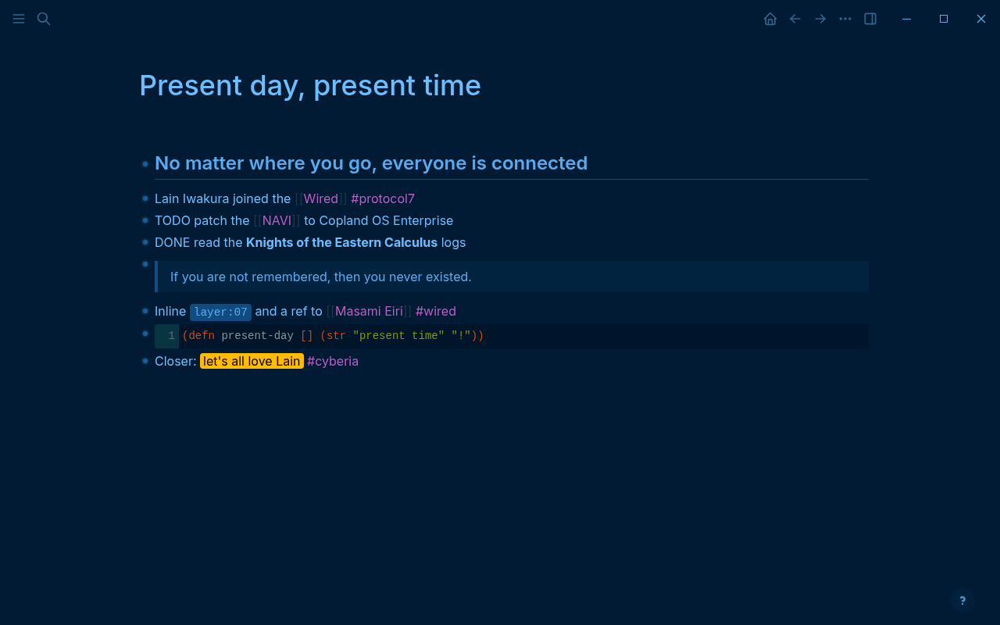

# Copland OS

A dark Logseq theme after *Serial Experiments Lain*: deep navy, wired blue text, cyan links, violet tags and a faint purple glow on page titles. Colors from the kitty terminal theme "Copland OS" by CrystalPixie (MIT).

## Install

From the marketplace: Plugins → Marketplace → Themes → Copland OS, then pick it in the theme switcher.

By hand: turn on Developer mode (Settings → Advanced), then Plugins → Load unpacked plugin → this folder.

Works with file graphs and DB graphs: it sets the classic `--ls-*` colors, the DB version's `--lx-gray-*` scale and its shadcn tokens.

## Colors

| role | color |
|---|---|
| background | `#001B33` |
| text | `#6EBEFF` |
| links, block refs | `#00d6a6` |
| tags | `#bb5dc3` |
| accent, title glow | `#8F1FFF` |
| selection | `#6EBEBD` |

## License

MIT
